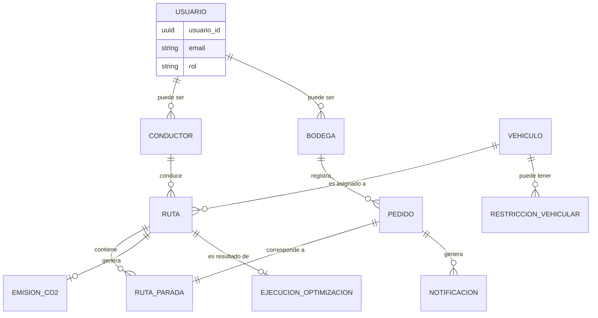

# Diseño e Ingeniería de Base de Datos

## Metadatos
- **Nombre del Proyecto:** EcoLogística Lima - Optimizador de Rutas Sostenibles
- **Integrantes:**
  - Fernandez Condor Jhon Smith
  - Perez Ordoñez Anthony Alexis
  - Tovar Arias Michael Aldo
- **Fecha:** 01 de septiembre de 2026 (actualizado el 28 de noviembre de 2026)
- **Versión:** 1.2.0

---

## 1. Modelo Conceptual (Diagrama Entidad-Relación)



## 2. Modelo Lógico

| Entidad | Atributos principales | PK | FK | Notas de normalización |
|---|---|---|---|---|
| `usuarios` | usuario_id, nombre, email, password_hash, rol, estado, creado_en | usuario_id | — | 3FN: el rol es un valor atómico, sin grupos repetitivos |
| `conductores` | conductor_id, usuario_id, licencia, telefono | conductor_id | usuario_id → usuarios | Separado de `usuarios` para no mezclar atributos exclusivos de conductor con los de cualquier usuario (RF-008) |
| `bodegas` | bodega_id, usuario_id, razon_social, direccion_referencial, ubicacion (geo) | bodega_id | usuario_id → usuarios | Idem; evita nulos masivos en `usuarios`; soporta el aislamiento por `bodega_id` (RN-010) |
| `vehiculos` | vehiculo_id, placa, capacidad_kg, tipo_combustible, factor_emision_co2, estado | vehiculo_id | — | Placa con restricción UNIQUE (RF-001) |
| `restricciones_vehiculares` | restriccion_id, vehiculo_id, dia_restringido, exonerado, motivo_exoneracion | restriccion_id | vehiculo_id → vehiculos | Modela Pico y Placa (RN-002) sin duplicar atributos en `vehiculos` |
| `pedidos` | pedido_id, bodega_id, direccion, ubicacion (geo), peso_kg, ventana_inicio, ventana_fin, estado, creado_en | pedido_id | bodega_id → bodegas | Cada pedido pertenece a una única bodega (dependencia funcional completa); soporta RF-002 |
| `rutas` | ruta_id, vehiculo_id, conductor_id, fecha, estado, distancia_km_total, distancia_base_km | ruta_id | vehiculo_id → vehiculos, conductor_id → conductores | `distancia_base_km` (sin optimizar) se conserva para calcular el CO₂ evitado de RF-010 |
| `ruta_paradas` | parada_id, ruta_id, pedido_id, orden_secuencia, hora_estimada, hora_real, evidencia_url | parada_id | ruta_id → rutas, pedido_id → pedidos | Tabla de asociación N:M resuelta con atributos propios (orden, evidencia); soporta RF-008 |
| `ejecuciones_optimizacion` | ejecucion_id, ruta_id, algoritmo_usado, tiempo_computo_ms, distancia_optimizada_km, es_reoptimizacion | ejecucion_id | ruta_id → rutas | Auditoría de RNF-001 (tiempo ≤ 45 s) y de las corridas de RF-007 (re-optimización) |
| `emisiones_co2` | emision_id, ruta_id, kg_co2_emitido, kg_co2_evitado, arboles_equivalentes, metodologia_calculo | emision_id | ruta_id → rutas | Soporta RF-010 (Compensación de Carbono) y RN-006/RN-009 |
| `notificaciones` | notificacion_id, pedido_id, canal, mensaje, enviado_en | notificacion_id | pedido_id → pedidos | Soporta RF-009 (Notificaciones a Clientes) |

Todas las tablas cumplen **Tercera Forma Normal (3FN):** cada atributo no clave depende únicamente de la clave primaria completa, sin dependencias transitivas (ej. `distancia_km_total` de `rutas` no se deriva de `vehiculo_id`, sino que es propia de la ejecución de esa ruta).

## 3. Modelo Físico (DDL SQL)

```sql
CREATE EXTENSION IF NOT EXISTS "pgcrypto";
CREATE EXTENSION IF NOT EXISTS postgis;

CREATE TABLE usuarios (
    usuario_id UUID PRIMARY KEY DEFAULT gen_random_uuid(),
    nombre VARCHAR(150) NOT NULL,
    email VARCHAR(255) NOT NULL UNIQUE,
    password_hash VARCHAR(255) NOT NULL,
    rol VARCHAR(30) NOT NULL CHECK (rol IN ('ADMIN_FLOTA','OPERADOR','CONDUCTOR','BODEGA','AUDITOR')),
    estado VARCHAR(20) NOT NULL DEFAULT 'ACTIVO',
    creado_en TIMESTAMP WITH TIME ZONE DEFAULT CURRENT_TIMESTAMP
);
CREATE INDEX idx_usuarios_email ON usuarios(email);

CREATE TABLE conductores (
    conductor_id UUID PRIMARY KEY DEFAULT gen_random_uuid(),
    usuario_id UUID NOT NULL REFERENCES usuarios(usuario_id),
    licencia VARCHAR(20) NOT NULL UNIQUE,
    telefono VARCHAR(20)
);

CREATE TABLE bodegas (
    bodega_id UUID PRIMARY KEY DEFAULT gen_random_uuid(),
    usuario_id UUID NOT NULL REFERENCES usuarios(usuario_id),
    razon_social VARCHAR(200) NOT NULL,
    direccion_referencial TEXT NOT NULL,
    ubicacion GEOGRAPHY(POINT, 4326) NOT NULL
);

CREATE TABLE vehiculos (
    vehiculo_id UUID PRIMARY KEY DEFAULT gen_random_uuid(),
    placa VARCHAR(10) NOT NULL UNIQUE,
    capacidad_kg NUMERIC(8,2) NOT NULL CHECK (capacidad_kg > 0),
    tipo_combustible VARCHAR(20) NOT NULL CHECK (tipo_combustible IN ('GASOLINA','DIESEL','GLP','HIBRIDO','ELECTRICO')),
    factor_emision_co2 NUMERIC(10,4),
    estado VARCHAR(20) NOT NULL DEFAULT 'DISPONIBLE'
);

CREATE TABLE restricciones_vehiculares (
    restriccion_id UUID PRIMARY KEY DEFAULT gen_random_uuid(),
    vehiculo_id UUID NOT NULL REFERENCES vehiculos(vehiculo_id),
    dia_restringido SMALLINT NOT NULL CHECK (dia_restringido BETWEEN 1 AND 7),
    exonerado BOOLEAN NOT NULL DEFAULT FALSE,
    motivo_exoneracion TEXT
);

CREATE TABLE pedidos (
    pedido_id UUID PRIMARY KEY DEFAULT gen_random_uuid(),
    bodega_id UUID NOT NULL REFERENCES bodegas(bodega_id),
    direccion TEXT NOT NULL,
    ubicacion GEOGRAPHY(POINT, 4326) NOT NULL,
    peso_kg NUMERIC(8,2) NOT NULL CHECK (peso_kg > 0),
    ventana_inicio TIMESTAMP WITH TIME ZONE NOT NULL,
    ventana_fin TIMESTAMP WITH TIME ZONE NOT NULL,
    estado VARCHAR(30) NOT NULL DEFAULT 'PENDIENTE',
    creado_en TIMESTAMP WITH TIME ZONE DEFAULT CURRENT_TIMESTAMP,
    CHECK (ventana_fin > ventana_inicio)
);
CREATE INDEX idx_pedidos_estado ON pedidos(estado);
CREATE INDEX idx_pedidos_bodega ON pedidos(bodega_id);

CREATE TABLE rutas (
    ruta_id UUID PRIMARY KEY DEFAULT gen_random_uuid(),
    vehiculo_id UUID NOT NULL REFERENCES vehiculos(vehiculo_id),
    conductor_id UUID NOT NULL REFERENCES conductores(conductor_id),
    fecha DATE NOT NULL,
    estado VARCHAR(20) NOT NULL DEFAULT 'PLANIFICADA',
    distancia_km_total NUMERIC(10,2),
    distancia_base_km NUMERIC(10,2)
);
CREATE INDEX idx_rutas_fecha ON rutas(fecha);

CREATE TABLE ruta_paradas (
    parada_id UUID PRIMARY KEY DEFAULT gen_random_uuid(),
    ruta_id UUID NOT NULL REFERENCES rutas(ruta_id) ON DELETE CASCADE,
    pedido_id UUID NOT NULL REFERENCES pedidos(pedido_id),
    orden_secuencia SMALLINT NOT NULL,
    hora_estimada TIMESTAMP WITH TIME ZONE,
    hora_real TIMESTAMP WITH TIME ZONE,
    evidencia_url TEXT,
    UNIQUE (ruta_id, orden_secuencia)
);

CREATE TABLE ejecuciones_optimizacion (
    ejecucion_id UUID PRIMARY KEY DEFAULT gen_random_uuid(),
    ruta_id UUID NOT NULL REFERENCES rutas(ruta_id),
    algoritmo_usado VARCHAR(30) NOT NULL,
    tiempo_computo_ms INTEGER NOT NULL CHECK (tiempo_computo_ms <= 45000),
    distancia_optimizada_km NUMERIC(10,2),
    es_reoptimizacion BOOLEAN NOT NULL DEFAULT FALSE
);

CREATE TABLE emisiones_co2 (
    emision_id UUID PRIMARY KEY DEFAULT gen_random_uuid(),
    ruta_id UUID NOT NULL REFERENCES rutas(ruta_id),
    kg_co2_emitido NUMERIC(10,4) NOT NULL,
    kg_co2_evitado NUMERIC(10,4),
    arboles_equivalentes NUMERIC(10,2),
    metodologia_calculo VARCHAR(30) NOT NULL DEFAULT 'GLEC_ISO14083'
);

CREATE TABLE notificaciones (
    notificacion_id UUID PRIMARY KEY DEFAULT gen_random_uuid(),
    pedido_id UUID NOT NULL REFERENCES pedidos(pedido_id),
    canal VARCHAR(20) NOT NULL CHECK (canal IN ('SMS','PUSH','EMAIL')),
    mensaje TEXT NOT NULL,
    enviado_en TIMESTAMP WITH TIME ZONE DEFAULT CURRENT_TIMESTAMP
);
```

---

## 4. Actualización del Sprint 2: modelo implementado frente al DDL

El DDL de la sección 3 sigue siendo el objetivo para PostgreSQL. En `src/backend/app/models.py` se implementaron **6 de las 11 tablas** (`usuarios`, `conductores`, `bodegas`, `vehiculos`, `restricciones_vehiculares` y `pedidos`); faltan `rutas`, `ruta_paradas`, `ejecuciones_optimizacion`, `emisiones_co2` y `notificaciones`.

| Aspecto | DDL de la sección 3 | Implementado (SQLite en desarrollo) | Decisión |
|---|---|---|---|
| Ubicación en `bodegas` y `pedidos` | `ubicacion GEOGRAPHY(POINT, 4326)` | Columnas `latitud` y `longitud` `NUMERIC(10,7)` | Compatibilidad con SQLite; migrar a PostGIS cuando se configure PostgreSQL |
| `usuarios` | Sin contador de intentos | Se agregan `login_attempts` (SMALLINT) y `locked_until` (fecha con zona horaria) | Soportan RN-001 y EN-002 (bloqueo de 15 minutos tras 3 intentos); se incorporan al DDL objetivo |
| Identificadores | `UUID` | `String(36)` con UUID en texto | Compatibilidad con SQLite |
| Restricciones `CHECK` (`rol`, `ventana_fin > ventana_inicio`, valores positivos) | Definidas en la base de datos | Validadas en los esquemas Pydantic; no replicadas como `CHECK` en el modelo ORM | Replicarlas en la migración a PostgreSQL |
| `ejecuciones_optimizacion.tiempo_computo_ms <= 45000` | `CHECK` en la tabla | Tabla no implementada | Pendiente con el motor de optimización (EN-001) |

DDL objetivo de `usuarios` con los dos campos nuevos:

```sql
ALTER TABLE usuarios
    ADD COLUMN login_attempts SMALLINT NOT NULL DEFAULT 0,
    ADD COLUMN locked_until TIMESTAMP WITH TIME ZONE;
```

## 5. Actualización del cierre (Etapa final): modelo implementado frente al DDL

Se implementaron las 11 tablas del DDL (con diferencias que se explican abajo) y se añadieron **4 tablas nuevas** necesarias para los requisitos (15 en total): `incidencias`, `zonas_protegidas`, `parametros_sistema` y `solicitudes_privacidad`. El modelo corre sobre SQLite en desarrollo y pruebas y sobre PostgreSQL en producción.

| Aspecto | DDL de la sección 3 | Implementado (`models.py`) | Decisión |
|---|---|---|---|
| `ejecuciones_optimizacion` | Una fila **por ruta**, con `tiempo_computo_ms <= 45000` | Una fila **por corrida del planificador**: algoritmo, pedidos planificados y sin asignar, kilómetros y CO₂ planificados y de la línea base, `tiempo_ms`, `limite_alcanzado`, `es_reoptimizacion` y `desde_cache` | Un planificador optimiza todas las rutas a la vez (relación 1 a N con `rutas`); el límite de 45 s se controla en el cálculo (40 s) y se prueba |
| `rutas` | `conductor_id`, `fecha`, `distancia_km_total`, `distancia_base_km` | `conductor_id`, `estado` (PLANIFICADA, EN_CURSO, COMPLETADA, CANCELADA, INTERRUMPIDA), `iniciada_en`, `completada_en`, `distancia_km`, `distancia_base_km`, `carga_kg`, `co2_kg`, `co2_base_kg` y `duracion_min` | La fecha se toma de `creado_en`; la línea base por ruta permite acumular el CO₂ evitado al completarla |
| `ruta_paradas` | `orden_secuencia`, `hora_estimada`, `hora_real`, `evidencia_url` | `orden`, `llegada_estimada`, `espera_min`, `en_ventana`, `estado`, `entregada_en`, ubicación de entrega, `evidencia_tipo`, `evidencia` (cifrada), `motivo` y `clave_sync` (única) | La clave de sincronización hace idempotente el envío desde el móvil; la evidencia se guarda cifrada en la base |
| `emisiones_co2` | Tabla propia por ruta | Tabla `emisiones_co2` con una fila por ruta completada: `kg_co2_emitido`, `kg_co2_evitado`, `arboles_equivalentes` | Se crea solo al completar la ruta (RN-009) |
| `notificaciones` | `pedido_id`, `canal` (SMS, PUSH, EMAIL), `mensaje`, `enviado_en` | `usuario_id` (destinatario), `pedido_id`, `tipo`, `canal` (PORTAL, EMAIL, SMS), `mensaje`, `hora_estimada`, `estado_envio` (ENVIADA o NO_ENTREGADA), `leida` | El destinatario es la cuenta de la bodega (RN-010); el canal PORTAL es el principal |
| `vehiculos` y `pedidos` | Sin volumen | Se añade `volumen_m3` a ambos y `distrito`, `reprogramaciones` y `entregado_en` a `pedidos` | Soportan RN-004, RF-005 y RF-008 |
| `usuarios` | Sin contacto | Se añaden `telefono` y `canal_notificacion` (PORTAL, EMAIL, SMS o NINGUNO) | Soportan RF-009 |
| Ubicación en `bodegas` y `pedidos` | `GEOGRAPHY(POINT, 4326)` | Columnas `latitud` y `longitud` cifradas | PostGIS no se usa; el cifrado de la ubicación (RNF-008) impide las consultas geoespaciales en la base, que no se necesitan porque el cálculo se hace en la aplicación |
| Fechas | `TIMESTAMP WITH TIME ZONE` | `DateTime(timezone=True)`; todo se guarda en UTC y un dato de entrada sin zona se entiende en hora de Lima | Necesario para PostgreSQL |
| Restricciones `CHECK` | Definidas en la base | Validadas en los esquemas Pydantic | Se mantienen en la capa de aplicación |

**Tablas nuevas.**

| Tabla | Para qué sirve | Requisito |
|---|---|---|
| `incidencias` | Registro de vías cerradas, accidentes, averías, retrasos y desvíos con su resultado y tiempo de recálculo | RF-007, RN-005 |
| `zonas_protegidas` | Círculos que ninguna ruta puede atravesar | RN-003 |
| `parametros_sistema` | Velocidad media, tiempo de descarga, límite de cálculo y algoritmo | Administración |
| `solicitudes_privacidad` | Solicitudes de eliminación o anonimización con su plazo de 5 días hábiles | RN-008, RNF-008 |

## 6. Clasificación y protección de datos personales (RNF-008, RN-008)

Los campos clasificados como personales o de ubicación se cifran con AES-SIV (AES-256 en modo SIV, cifrado autenticado) antes de llegar a la base de datos y se descifran al leerlos. El cifrado es **determinista**: el mismo texto produce el mismo valor cifrado, lo que mantiene las restricciones de unicidad y la búsqueda por igualdad (por ejemplo, el inicio de sesión por correo) sin guardar el dato en claro. La clave viene de `DATA_ENCRYPTION_KEY` (o, si falta, se deriva de `SECRET_KEY`) y nunca se escribe en el repositorio.

| Tabla | Campos cifrados | Campos sin cifrar y por qué |
|---|---|---|
| `usuarios` | `nombre`, `email`, `telefono` | `rol`, `estado` y `canal_notificacion` (no identifican a la persona); `password_hash` ya es un resumen bcrypt |
| `conductores` | `licencia`, `telefono` | `activo` |
| `bodegas` | `direccion_referencial`, `latitud`, `longitud` | `razon_social` (dato de una empresa) |
| `pedidos` | `direccion`, `latitud`, `longitud` | `peso_kg`, `volumen_m3`, `distrito` y ventanas (no localizan a una persona) |
| `ruta_paradas` | `latitud_entrega`, `longitud_entrega`, `evidencia` (foto o firma) | `estado`, tiempos y `clave_sync` |

**Consecuencia de diseño.** Una base de datos cifrada no puede buscar por dirección: la búsqueda de pedidos por texto se hace sobre las filas ya descifradas por la aplicación (hasta 5.000 filas).

**Eliminación y anonimización (RN-008).** Cualquier usuario puede pedir la baja de sus datos; la solicitud queda con un plazo límite de 5 días hábiles. Al atenderla, un administrador distinto del titular anonimiza la cuenta: nombre, correo y teléfono se reemplazan por valores genéricos, la licencia y las ubicaciones de entrega se borran, las direcciones y coordenadas de la bodega y de sus pedidos pasan a «Dato anonimizado» y las notificaciones se eliminan. Los totales de los reportes se conservan. La eliminación física solo se permite para cuentas sin historial.

**Reportes y privacidad.** El rol AUDITOR recibe los reportes sin direcciones ni coordenadas.

## Historial de Control de Cambios

| Versión | Fecha | Cambio |
|---|---|---|
| 1.0.0 | 01/09/2026 | Creación del documento: modelo conceptual, lógico (3FN) y físico (11 tablas). |
| 1.1.0 | 05/10/2026 | Se agrega la sección 4 con el modelo implementado en el Sprint 1 (6 de 11 tablas), sus diferencias con el DDL y los campos `login_attempts` y `locked_until` para RN-001; el DDL de la sección 3 no se modifica. |
| 1.2.0 | 28/11/2026 | Cierre: se agrega la sección 5 con las tablas de rutas implementadas (9 de 11) y sus diferencias con el DDL. |
| 1.3.0 | 28/11/2026 | Se actualiza la sección 5 (11 tablas del DDL y 4 nuevas, 15 en total) y se agrega la sección 6 con la clasificación de datos personales, el cifrado y la anonimización. |

---

[← Volver al README Principal](../../README.md)
