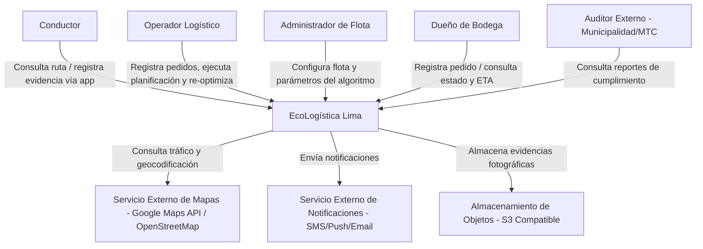
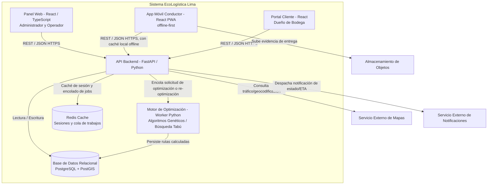
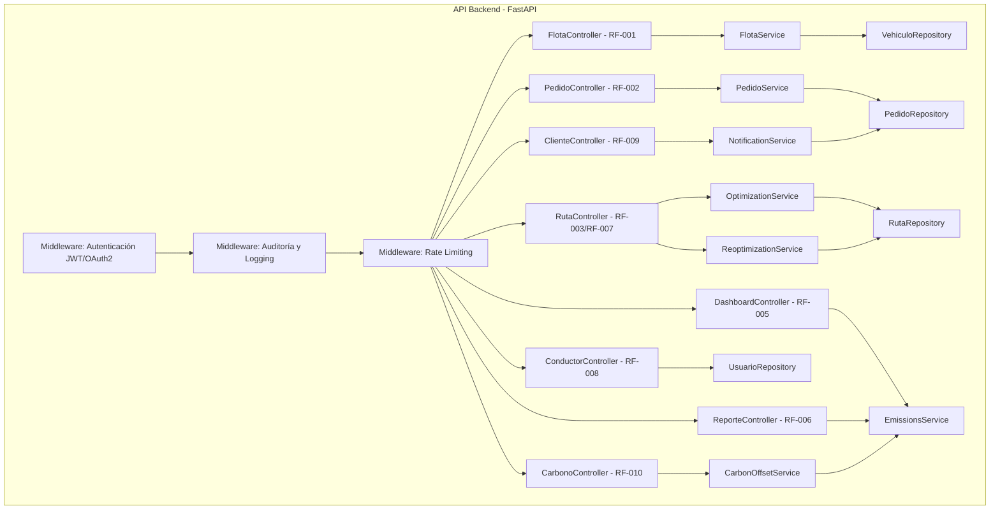

# Arquitectura de Software - Modelo C4

## Metadatos
- **Nombre del Proyecto:** EcoLogística Lima - Optimizador de Rutas Sostenibles
- **Integrantes:**
  - Fernandez Condor Jhon Smith
  - Perez Ordoñez Anthony Alexis
  - Tovar Arias Michael Aldo
- **Fecha:** 01 de septiembre de 2026 (actualizado el 28 de noviembre de 2026)
- **Versión:** 1.3.0

---

## Nivel 1: Diagrama de Contexto

## Nivel 2: Diagrama de Contenedores

## Nivel 3: Diagrama de Componentes (API Backend)

Estructuración interna de los módulos que componen el contenedor de la API (Controladores, Servicios, Repositorios, Middleware de Seguridad), alineada 1 a 1 con los requisitos funcionales del Documento 06:

---

## Estado de implementación al 05/10/2026 (Sprints 1 y 2)

| Contenedor / componente | Estado | Observación |
|---|---|---|
| Panel web (React) | Parcial | Inicio de sesión, inicio, vehículos y pedidos |
| App móvil del conductor (PWA) y portal del cliente | No implementados | RF-004, RF-008 y RF-009 |
| API backend (FastAPI) | Parcial | Autenticación, vehículos y pedidos |
| Motor de optimización | No implementado | Pendiente del spike EN-001 (RSK-05) |
| Base de datos | Parcial | SQLite en desarrollo; PostgreSQL/PostGIS pendiente (ver Documento 11, sección 4) |
| Redis | No implementado | Depende del motor (EN-009) |
| Servicios externos (mapas, notificaciones, almacenamiento) | No implementados | Corresponden a EP-04 y EP-02 |

**Desviación a nivel de componentes:** el backend se organizó en `routers`, `schemas`, `models` y `auth`; los routers acceden directamente al ORM, sin las capas de servicios y repositorios del diagrama del nivel 3. Es una simplificación aceptable mientras hay solo tres módulos; debe revisarse al incorporar el motor de optimización para no acoplar la lógica de dominio a los endpoints.

## Despliegue en producción al 16/11/2026 (Sprint 4)

Los diagramas no cambian; sí cambia cómo se empaquetan los contenedores del nivel 2 en producción:

| Contenedor del nivel 2 | En producción |
|---|---|
| Panel web (React) | Se compila en la primera etapa del `Dockerfile` y lo entrega la propia API desde el mismo origen (sin servidor web aparte) |
| API backend (FastAPI) | Imagen Docker con usuario sin privilegios; escucha en el puerto que asigna el proveedor y expone `/api/health` y `/api/health/ready` (comprueba la base de datos) para su comprobación de salud |
| Base de datos | PostgreSQL gestionado por Render (definido en `render.yaml`); SQLite en desarrollo y pruebas |
| Canal de entrega | GitHub Actions (`deploy-production.yml`) construye y verifica; Render publica la imagen mediante un Deploy Hook ([Guía de despliegue](../03%20Inplementaci%C3%B3n/Sprint%204/05%20Gu%C3%ADa%20de%20despliegue.md)) |

La estrategia de pruebas de aceptación sobre este despliegue está en el [Análisis Playwright](../03%20Inplementaci%C3%B3n/Sprint%204/03%20Analisis%20PlayWrigth%20V_1_0_0.md).

## Estado de implementación al 28/11/2026 (cierre del Sprint 4)

| Contenedor / componente | Estado | Observación |
|---|---|---|
| Panel web (React) | Implementado | Dashboard con filtros, flota, pedidos con mapa, rutas con incidencias, notificaciones y administración; menú y rutas por rol |
| App del conductor (PWA) | Implementado | Misma aplicación web instalable (`/conductor`): service worker, cola sin conexión y firma o foto como evidencia |
| Portal del cliente | Implementado | Pantalla de notificaciones de la bodega (RF-009), aislada por cuenta |
| API backend (FastAPI) | Implementado | Routers de auth, vehículos, pedidos, rutas, conductor, notificaciones, administración, privacidad, indicadores y reportes, cada uno con control por rol |
| Motor de optimización | Implementado | `optimizador.py` (Clarke-Wright, 2-opt, restricciones duras y caché) y `algoritmos_alternativos.py` (búsqueda tabú y genético), desacoplados de la API y la base |
| Base de datos | Implementado | 15 tablas, datos personales cifrados; PostgreSQL en producción |
| Servicios externos | Parcial | Teselas de OpenStreetMap; correo por SMTP configurable (el modo por defecto es el portal); sin servicio de tráfico ni de SMS |
| Caché | Implementado en memoria | Caché de matrices y planes dentro del proceso; Redis no se usó (ver Documento 10, sección 7) |
| Balanceador | Solo en la prueba de conmutación | nginx con dos instancias en `docker-compose.failover.yml`; la producción gratuita tiene una instancia |

**Componentes nuevos del nivel 3 (API Backend).** `RutasRouter`, `ConductorRouter`, `NotificacionesRouter`, `AdminRouter`, `IndicadoresRouter`, `ReportesRouter`, el módulo de servicios (`servicios.py`: planificación, re-optimización, notificaciones y cierre de ruta), `Cifrado` (tipos de columna que cifran y descifran) y `Optimizador`. Los routers delegan la lógica de negocio en los servicios; el optimizador sigue aislado y se invoca fuera del bucle de eventos.

## Historial de Control de Cambios

| Versión | Fecha | Cambio |
|---|---|---|
| 1.0.0 | 01/09/2026 | Creación del documento: C4 niveles 1, 2 y 3. |
| 1.1.0 | 05/10/2026 | Se agrega el estado de implementación por contenedor y la desviación en la organización de componentes del backend; los diagramas no cambian. |
| 1.2.0 | 16/11/2026 | Sprint 4: se agrega la vista de despliegue en producción (un solo contenedor Docker, canal de entrega con GitHub Actions y Render); los diagramas no cambian. |
| 1.3.0 | 28/11/2026 | Cierre: se agrega el estado de implementación al 28/11/2026 y los componentes nuevos (motor de optimización, routers de rutas, indicadores y reportes); los diagramas no cambian. |
| 1.4.0 | 28/11/2026 | Se actualiza el estado de implementación (PWA del conductor, portal de notificaciones, administración, PostgreSQL y cifrado) y los componentes del nivel 3; los diagramas no cambian. |

---

[← Volver al README Principal](../../README.md)
