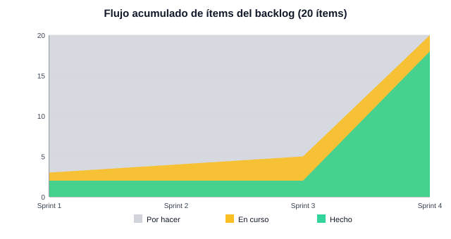
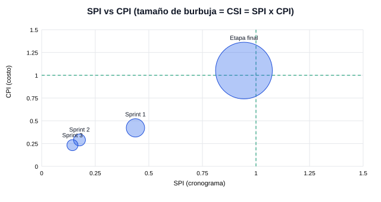
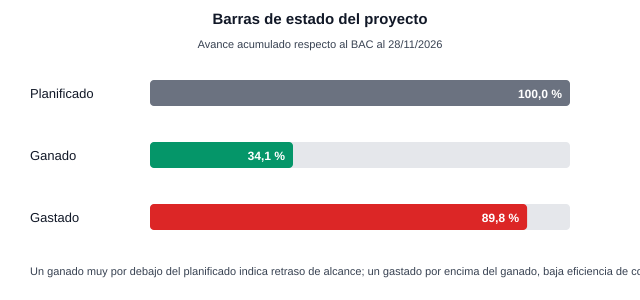

[⬅️ Volver al README Principal](../../README.md)

# Tableros de Control Híbridos (Hybrid Dashboards)

- **Proyecto:** EcoLogística Lima - Optimizador de Rutas Sostenibles para DistriRápido S.A.C.  |  **Frecuencia de Actualización:** al cierre de cada sprint (cada 2 semanas) y antes de cada revisión; el estado del CI, de las pruebas y de producción se actualiza en cada cambio, de forma automática  |  **Versión:** 1.0.0

> **Cómo leer este tablero.** Reúne en una sola vista lo **predictivo** (plan, presupuesto y cronograma medidos con EVM) y lo **adaptativo** (backlog, tablero Scrum, calidad y despliegue). Fecha de corte: 28/11/2026. Los gráficos se generan con [`calcular_evm.py`](../../scripts/calcular_evm.py) a partir de los datos del [Reporte de EVM](03%20Reporte%20de%20An%C3%A1lisis%20de%20Valor%20Ganado%20-%20EVM%20V_1_0_0.md); los valores de costo son estimaciones declaradas allí.

## 1. Justificación de Métricas (Principio Less is More)

- **Necesidades de los interesados:**
  - **Docente / Product Owner:** saber en una mirada si el alcance se cumplió y si el producto funciona (SPI, avance del backlog, estado de las pruebas y de producción).
  - **Líder del proyecto:** controlar presupuesto y ruta crítica (CPI, costo acumulado, EAC y riesgos).
  - **Equipo técnico:** detectar rápido cuándo se rompe la calidad (CI, cobertura, E2E, rendimiento).
  - **Cliente ficticio DistriRápido:** ver el beneficio ambiental (CO₂ evitado y árboles equivalentes).
- **Criterios de selección de KPIs:** se muestran **12 indicadores** y se descartaron los que no cambian una decisión. Cada KPI cumple tres reglas: (1) responde una pregunta de un interesado, (2) se calcula con datos verificables del repositorio o de Actions y (3) tiene un umbral que lo vuelve verde, ámbar o rojo. Se dejó fuera, por ejemplo, la velocidad por integrante, porque el equipo es de tres personas y no ayuda a decidir.

## 2. Tabla Semáforo (RAG Chart) por Componente

Umbrales: 🟢 cumple la meta · 🟡 cumple con reservas o con trabajo pendiente acotado · 🔴 no cumple la meta.

| Componente / Entregable | Enfoque (Predictivo/Adaptativo) | Estado (🟢 Verde / 🟡 Ámbar / 🔴 Rojo) | Observación / Umbral |
|---|---|---|---|
| Alcance del backlog (116 puntos) | Predictivo | 🔴 Rojo | EV 34,1 % del BAC; umbral verde: SPI ≥ 0,9. SPI = 0,341 |
| Cronograma (hitos de la hoja de ruta) | Predictivo | 🔴 Rojo | Motor de rutas 12 días tarde; dashboard y reportes 33 días tarde |
| Costo (presupuesto USD 22.469,00) | Predictivo | 🟢 Verde | Gasto estimado 89,8 % del BAC, reserva de 12 % sin usar; umbral verde: costo ≤ BAC. CPI 0,379 se explica en el EVM |
| Motor de rutas (RF-003) | Adaptativo | 🟢 Verde | 50 pedidos en 4 a 31 ms; umbral: ≤ 45.000 ms (RNF-001) |
| Mapa, dashboard, reportes y CO₂ (RF-004, 005, 006, 010) | Adaptativo | 🟡 Ámbar | MVP funcional; faltan filtros por distrito y fechas, PDF y cierre de ruta "Completada" |
| Calidad de código | Adaptativo | 🟢 Verde | Backend 94,1 % de cobertura (meta 80 %); 0 bugs y 0 vulnerabilidades en SonarQube (21/10/2026) |
| Pruebas E2E (3 navegadores + móvil) | Adaptativo | 🟢 Verde | 152 de 152 ejecuciones (100 %) |
| CI/CD (4 flujos de GitHub Actions) | Adaptativo | 🟢 Verde | `CI`, `Tests`, `Deploy Production` y Green IT en verde en `main` |
| Rendimiento y disponibilidad en producción | Adaptativo | 🟢 Verde | Mediana 295 ms (meta < 500 ms); 30 de 30 sondeos correctos; muestra corta |
| Usabilidad (SUS) | Adaptativo | 🟡 Ámbar | SUS 79,4 (A-), pero con datos **simulados**; meta ≥ 68 |
| Seguridad y datos personales | Predictivo | 🟡 Ámbar | Bloqueo, roles y cabeceras verificados; faltan prueba de penetración y cifrado de campos (EN-002, EN-008) |
| Aceptación del Product Owner | Predictivo | 🟡 Ámbar | US-001 y US-003 cumplen la definición de hecho técnica; falta la demostración en vivo y su acta |

**Resumen del semáforo:** 6 verdes, 4 ámbar y 2 rojos. Los dos rojos (alcance y cronograma) vienen del trabajo diferido; el costo está controlado.

## 3. Gráficos de Desempeño Predictivo y Ágil

- **3.1 Tendencias de Variación y Valor Ganado (Líneas):** Imagen  — Interpretación: la línea gris (PV) sube hasta el 100 % en el Sprint 4; la roja (AC, gasto) la sigue de cerca, y la verde (EV) se queda muy abajo hasta el Sprint 5, cuando salta de USD 2.614,93 a USD 7.651,08. La distancia entre la gris y la verde es el atraso de alcance; la distancia entre la roja y la verde, la variación de costo. Los índices por sprint  muestran que ambos tocaron fondo en el Sprint 4 (SPI 0,116 y CPI 0,150) y empezaron a recuperarse en el Sprint 5 (0,341 y 0,379).
- **3.2 Flujo Acumulado / Áreas Apiladas:** Imagen  — Interpretación: la franja "Por hacer" casi no se reduce hasta el Sprint 5 (de 20 a 15 ítems), señal de que el flujo estaba detenido. En el Sprint 5 la franja "En curso" se ensancha de 3 a 9 ítems, porque el trabajo se repartió en varios ítems a la vez y quedaron parciales; la franja "Hecho" llega a 3. Es el cuello de botella a vigilar: demasiado trabajo en curso y poco terminado.
- **3.3 Relación Costo-Cronograma (SPI vs. CPI con tamaño CSI):** Imagen  — Interpretación: cada burbuja es un sprint; su posición es (SPI, CPI) y su tamaño el **CSI = SPI × CPI** (índice de cronograma-costo). Todas están en el cuadrante inferior izquierdo (ambos índices menores que 1, la peor zona). La burbuja del Sprint 5, más grande y desplazada hacia arriba y a la derecha (CSI = 0,129), es la única que mejora; para cerrar la brecha debe llegar a la intersección de las líneas verdes (1,0 y 1,0).
- **3.4 Medidores de Estado (Gauges) / Gráficos de Barras:** Imagen  — Interpretación: tres barras sobre el BAC: planificado 100,0 %, ganado 34,1 % y gastado 89,8 %. Si lo gastado supera a lo ganado por tanto margen (55,7 puntos), el dinero se usó en trabajo que el plan no acredita; es el argumento para el re-baselining propuesto en el [Reporte de EVM](03%20Reporte%20de%20An%C3%A1lisis%20de%20Valor%20Ganado%20-%20EVM%20V_1_0_0.md).

## Referencias cruzadas

- Cálculos: [Reporte de EVM](03%20Reporte%20de%20An%C3%A1lisis%20de%20Valor%20Ganado%20-%20EVM%20V_1_0_0.md) y [Reporte de Variación](02%20Reporte%20de%20Variaci%C3%B3n%20V_1_0_0.md).
- Radiadores ágiles (burndown, burnup, Kanban, mood y retrospectiva): [Radiadores de Información](05%20Radiadores%20de%20Informaci%C3%B3n%20V_1_0_0.md).
- Evidencia de calidad: [Matriz de cumplimiento](../03%20Inplementaci%C3%B3n/Sprint%205/01%20Matriz%20de%20cumplimiento%20V_1_0_0.md) y [Análisis Playwright](../03%20Inplementaci%C3%B3n/Sprint%204/03%20Analisis%20PlayWrigth%20V_1_0_0.md).
