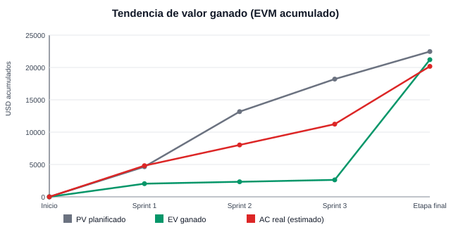
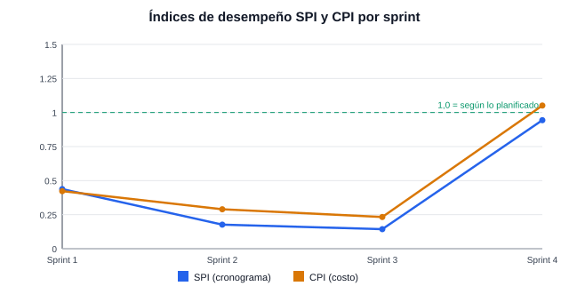

[⬅️ Volver al README Principal](../../README.md)

# Tableros de Control Híbridos (Hybrid Dashboards)

- **Proyecto:** EcoLogística Lima - Optimizador de Rutas Sostenibles para DistriRápido S.A.C.  |  **Frecuencia de Actualización:** al cierre de cada sprint (cada 2 semanas) y antes de cada revisión; el estado del CI, de las pruebas y de producción se actualiza en cada cambio, de forma automática  |  **Versión:** 2.0.0

> **Cómo leer este tablero.** Reúne en una sola vista lo **predictivo** (plan, presupuesto y cronograma medidos con EVM) y lo **adaptativo** (backlog, tablero Scrum, calidad y despliegue). Fecha de corte: 28/11/2026. Los gráficos se generan con [`calcular_evm.py`](../../scripts/calcular_evm.py) a partir de los datos del [Reporte de EVM](03%20Reporte%20de%20An%C3%A1lisis%20de%20Valor%20Ganado%20-%20EVM%20V_1_0_0.md); los valores de costo son estimaciones declaradas allí.

## 1. Justificación de Métricas (Principio Less is More)

- **Necesidades de los interesados:**
  - **Docente / Product Owner:** saber en una mirada si el alcance se cumplió y si el producto funciona (SPI, avance del backlog, estado de las pruebas y de producción).
  - **Líder del proyecto:** controlar presupuesto y ruta crítica (CPI, costo acumulado, EAC y riesgos).
  - **Equipo técnico:** detectar rápido cuándo se rompe la calidad (CI, cobertura, E2E, rendimiento).
  - **Cliente ficticio DistriRápido:** ver el beneficio ambiental (CO₂ evitado y árboles equivalentes).
- **Criterios de selección de KPIs:** se muestran **12 indicadores** y se descartaron los que no cambian una decisión. Cada KPI cumple tres reglas: (1) responde una pregunta de un interesado, (2) se calcula con datos verificables del repositorio o de Actions y (3) tiene un umbral que lo vuelve verde, ámbar o rojo. Se dejó fuera, por ejemplo, la velocidad por integrante, porque el equipo es de tres personas y no ayuda a decidir.

## 2. Tabla Semáforo (RAG Chart) por Componente

Umbrales: 🟢 cumple la meta · 🟡 cumple con reservas o con trabajo pendiente acotado · 🔴 no cumple la meta.

| Componente / Entregable | Enfoque (Predictivo/Adaptativo) | Estado (🟢 Verde / 🟡 Ámbar / 🔴 Rojo) | Observación / Umbral |
|---|---|---|---|
| Alcance del backlog (116 puntos) | Predictivo | 🟢 Verde | EV 94,4 % del BAC; umbral verde: SPI ≥ 0,9. SPI = 0,944. Quedan 6,5 puntos (EN-003 y EN-006) que exigen infraestructura de pago |
| Cronograma (hitos de la hoja de ruta) | Predictivo | 🟡 Ámbar | Todo el alcance llegó, pero tarde: motor de rutas 12 días, dashboard y reportes 33 días y spike EN-001 54 días después de lo planificado |
| Costo (presupuesto USD 22.469,00) | Predictivo | 🟢 Verde | Gasto estimado 89,8 % del BAC, reserva de 12 % sin usar; umbral verde: costo ≤ BAC. CPI 1,051 |
| Motor de rutas (RF-003, RF-007) | Adaptativo | 🟢 Verde | 1.000 pedidos en alrededor de 1 s; umbral: ≤ 45.000 ms (RNF-001); re-optimización en milisegundos |
| Mapa, dashboard, reportes, CO₂ y notificaciones (RF-004, 005, 006, 009, 010) | Adaptativo | 🟢 Verde | Los diez requisitos funcionales cumplen sus criterios de aceptación con pruebas automáticas |
| Calidad de código | Adaptativo | 🟢 Verde | Backend 93,4 % de cobertura (meta 80 %); 0 hallazgos de Ruff, Bandit, ESLint y `tsc`; 0 bugs y 0 vulnerabilidades en SonarQube (21/10/2026) |
| Pruebas E2E (3 navegadores + móvil) | Adaptativo | 🟢 Verde | {E2E} ejecuciones, 100 % de éxito, incluidas la app del conductor sin conexión y la accesibilidad con axe-core |
| CI/CD (flujos de GitHub Actions) | Adaptativo | 🟢 Verde | `CI`, `Tests` (con PostgreSQL real y conmutación por falla), `Deploy Production` y Green IT |
| Rendimiento y disponibilidad en producción | Adaptativo | 🟡 Ámbar | Mediana 295 ms (meta < 500 ms) y 30 de 30 sondeos correctos, pero muestra corta y una sola instancia en el plan gratuito; el RTO se midió con dos instancias en CI |
| Usabilidad (SUS) | Adaptativo | 🟡 Ámbar | SUS 79,4 (A-), pero con datos **simulados**; meta ≥ 68. Entregar una parada toma 3 toques y menos de 20 s |
| Seguridad y datos personales | Predictivo | 🟢 Verde | Cifrado AES-SIV, anonimización en 5 días hábiles, pruebas ofensivas automáticas y HSTS; sin auditoría externa |
| Aceptación del Product Owner | Predictivo | 🟡 Ámbar | Las historias cumplen la definición de hecho técnica; falta la demostración en vivo y su acta |

**Resumen del semáforo:** 8 verdes, 4 ámbar y ningún rojo. Los ámbar son de cronograma, de validación con terceros (usuarios y Product Owner) y de infraestructura de pago.

## 3. Gráficos de Desempeño Predictivo y Ágil

- **3.1 Tendencias de Variación y Valor Ganado (Líneas):** Imagen  — Interpretación: la línea gris (PV) sube hasta el 100 % en la etapa final; la roja (AC, gasto) la sigue de cerca, y la verde (EV) se queda muy abajo durante los Sprints 1 a 3 y salta de USD 2.614,93 a USD 21.209,96 en la etapa final. La distancia final entre la gris y la verde, USD 1.259,04, es el atraso de alcance; la verde queda por encima de la roja, es decir, se ganó más valor del que costó el tiempo. Los índices por sprint  muestran que ambos tocaron fondo en el Sprint 3 (SPI 0,144 y CPI 0,233) y se recuperaron en la etapa final (0,944 y 1,051).
- **3.2 Flujo Acumulado / Áreas Apiladas:** Imagen  — Interpretación: la franja "Por hacer" casi no se reduce durante los Sprints 1 a 3 (de 17 a 15 ítems), señal de que el flujo estaba detenido; en la etapa final desaparece y la franja "Hecho" pasa de 2 a 18 ítems. Quedan 2 ítems "En curso" (EN-003 y EN-006), que esperan infraestructura de pago. El cuello de botella del periodo anterior era dejar todo para el final: se terminó mucho de una vez, lo que es riesgoso aunque haya funcionado.
- **3.3 Relación Costo-Cronograma (SPI vs. CPI con tamaño CSI):** Imagen  — Interpretación: cada burbuja es un sprint; su posición es (SPI, CPI) y su tamaño el **CSI = SPI × CPI** (índice de cronograma-costo). Los Sprints 1 a 3 están en el cuadrante inferior izquierdo (ambos índices menores que 1, la peor zona). La burbuja de la etapa final, la más grande (CSI = 0,992), queda casi sobre la intersección de las líneas verdes (1,0 y 1,0): el proyecto cierra en el plan en costo y casi en alcance.
- **3.4 Medidores de Estado (Gauges) / Gráficos de Barras:** Imagen  — Interpretación: tres barras sobre el BAC: planificado 100,0 %, ganado 94,4 % y gastado 89,8 %. Lo ganado supera a lo gastado por 4,6 puntos: el dinero se convirtió en alcance; los 5,6 puntos que faltan para igualar lo planificado son los 6,5 puntos de EN-003 y EN-006.

## Referencias cruzadas

- Cálculos: [Reporte de EVM](03%20Reporte%20de%20An%C3%A1lisis%20de%20Valor%20Ganado%20-%20EVM%20V_1_0_0.md) y [Reporte de Variación](02%20Reporte%20de%20Variaci%C3%B3n%20V_1_0_0.md).
- Radiadores ágiles (burndown, burnup, Kanban, mood y retrospectiva): [Radiadores de Información](05%20Radiadores%20de%20Informaci%C3%B3n%20V_1_0_0.md).
- Evidencia de calidad: [Matriz de cumplimiento](../03%20Inplementaci%C3%B3n/Etapa%20final/06%20Matriz%20de%20cumplimiento%20V_1_0_0.md) y [Análisis Playwright](../03%20Inplementaci%C3%B3n/Etapa%20final/03%20Analisis%20PlayWrigth%20V_1_0_0.md).
