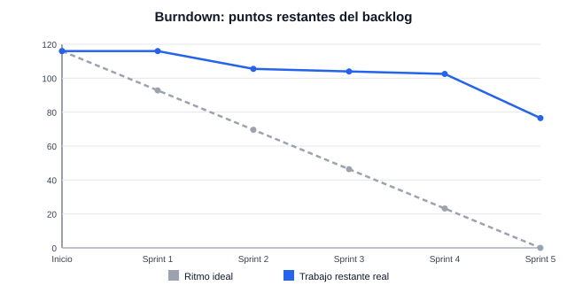
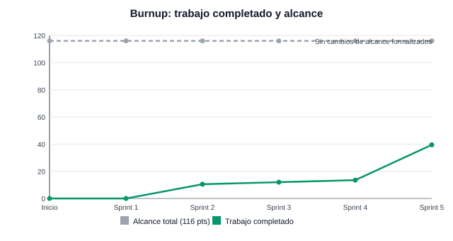
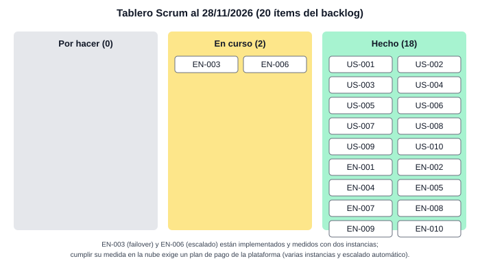
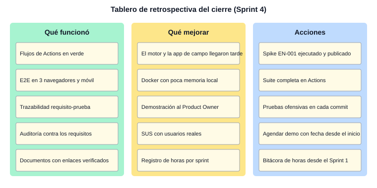

[⬅️ Volver al README Principal](../../README.md)

# Radiadores de Información (Information Radiators)

- **Proyecto:** EcoLogística Lima - Optimizador de Rutas Sostenibles para DistriRápido S.A.C.  |  **Marco Ágil Utilizado:** Scrum (5 sprints de 2 a 4 semanas) con GitFlow, Pull Requests y backlog de 20 ítems en Jira  |  **Versión:** 1.0.0

> **Cómo leer este documento.** Un radiador de información es un gráfico grande y simple que cualquiera entiende de un vistazo. **Origen de los datos:** Jira no se mantuvo al día durante el proyecto (el Sprint 1 siguió "activo" y no se creó el Sprint 2; ver IMP-004 en el [registro de impedimentos del Sprint 2](../03%20Inplementaci%C3%B3n/Sprint%2002/02%20Registro%20de%20Impedimentos%20V_1_0_0.md)), por lo que sus tableros no reflejan el avance real. Los gráficos de este documento se **generaron a partir de los datos verificables de cada sprint** (revisiones, pruebas y commits) con el script [`calcular_evm.py`](../../scripts/calcular_evm.py), que se puede ejecutar de nuevo. Fecha de corte: 28/11/2026.

- **1. Burndown Chart (Trabajo Restante):**  — Análisis de velocidad y tasa de finalización:

  La línea gris punteada es el ritmo ideal (de 116 puntos al inicio a 0 en cinco sprints) y la azul, el trabajo que realmente quedaba por hacer. **Puntos restantes al cierre de cada sprint:** 116, 105,5, 104, 102,5 y 76,5. **Velocidad (puntos ganados por sprint):** 0, 10,5, 1,5, 1,5 y 26,0; promedio de 7,9 puntos por sprint. La curva real se mantuvo casi plana durante tres sprints y cayó en el último, cuando el trabajo se concentró en la ruta crítica. Para vaciar los 76,5 puntos restantes a la velocidad del Sprint 5 hacen falta unas **3 iteraciones más**, por eso se propone reducir el alcance.

- **2. Burnup Chart (Trabajo Completado y Cambios de Alcance):**  — Análisis de crecimiento de alcance vs. trabajo aceptado:

  El alcance (línea punteada) se mantuvo en **116 puntos**: no se formalizó ningún cambio de alcance. El trabajo completado (línea verde) llegó a **39,5 puntos (34,1 %)**: 3 ítems completos y 9 parciales con el 50 % acreditado. La brecha entre las dos líneas son los 76,5 puntos pendientes. Lo que no aparece en el gráfico es el trabajo de calidad, seguridad, Green IT, pruebas E2E y despliegue, que sí se hizo pero no tenía puntos en el backlog; es la razón del re-baselining propuesto en el [Reporte de EVM](03%20Reporte%20de%20An%C3%A1lisis%20de%20Valor%20Ganado%20-%20EVM%20V_1_0_0.md).

- **3. Task Board / Tablero Kanban:**  — Análisis de flujo y cuellos de botella identificados:

  Instantánea al 28/11/2026 de los 20 ítems del backlog: **3 en Hecho** (US-001, US-003 y EN-005), **9 en curso** con la mitad del trabajo hecho (EN-001, EN-002, EN-007, EN-009, US-005, US-007, US-008, US-009 y US-010) y **8 por hacer** (US-002, US-004, US-006, EN-003, EN-004, EN-006, EN-008 y EN-010). **Cuellos de botella:** (1) **demasiado trabajo en curso a la vez** (9 ítems frente a una recomendación de 3); (2) ítems que no pueden terminar porque dependen de algo que no existe, como la app móvil del conductor (RF-004 completo, RF-010) o la aceptación del Product Owner; (3) la columna "En revisión" no se usó, de modo que nada recibía una revisión formal antes de pasar a "Hecho". El flujo acumulado del [tablero de control](04%20Tableros%20de%20Control%20-%20H%C3%ADbridos%20V_1_0_0.md) muestra cómo se llegó a esta foto.

- **4. Mood Chart (Estado de Ánimo del Equipo)**

> **Aviso de transparencia.** Los valores son una **estimación por rol** construida a partir de lo que registran las retrospectivas y los impedimentos de cada sprint (carga de trabajo, defectos críticos, problemas de herramientas). **No son la opinión declarada de cada integrante**: deben validarse con el equipo en la reunión de cierre y reemplazarse por los valores reales si difieren. Escala: 1 = muy bajo, 2 = bajo, 3 = neutral, 4 = bueno, 5 = muy bueno.

| Integrante / Rol | Sprint 1 | Sprint 2 | Sprint 3 | Sprint Final (4 y 5) |
|---|---|---|---|---|
| Fernandez Condor Jhon Smith (arquitecto y desarrollador de backend y algoritmo) | 3 😐 | 2 😕 | 4 🙂 | 4 🙂 |
| Perez Ordoñez Anthony Alexis (líder, desarrollador de frontend y diseño) | 3 😐 | 3 😐 | 4 🙂 | 3 😐 |
| Tovar Arias Michael Aldo (aseguramiento de calidad) | 3 😐 | 3 😐 | 4 🙂 | 4 🙂 |
| **Promedio del equipo** | **3,0** | **2,7** | **4,0** | **3,7** |

**Interpretación del clima laboral:** el clima empezó neutral (Sprint 1) porque el alcance comprometido no estaba confirmado en Jira (IMP-001 a IMP-004). Bajó en el Sprint 2 (2,7), cuando aparecieron defectos críticos de seguridad (DEF-001 a DEF-003) y la ausencia de integración continua. Subió a su mejor nivel en el Sprint 3 (4,0) al cerrar los defectos, crear el CI y medir calidad con SonarQube, OWASP y accesibilidad. En el tramo final se mantuvo bueno (3,7): la entrega del motor de rutas y la producción en línea compensaron la presión de los plazos y los problemas de herramientas (memoria de Docker, rutas largas en Windows). La lección es que el ánimo mejora cuando los problemas se **miden y se resuelven con herramientas** (CI, pruebas automáticas) y baja cuando el alcance es incierto.

- **5. Tableros de Retrospectiva**
  - **Evidencia:** 
  - **Lo que funcionó bien:** tres flujos de GitHub Actions en verde, pruebas E2E en tres navegadores, trazabilidad de la historia al commit y al Pull Request, motor de rutas con 98 % de cobertura y documentación con enlaces verificados automáticamente. | **Oportunidades de mejora:** la ruta crítica (el motor de optimización) se inició tarde, Docker con poca memoria obligó a ejecutar las pruebas en la nube, la demostración con el Product Owner sin fecha, el SUS con datos simulados y la falta de un registro de horas por sprint. | **Acciones implementadas:** ejecución de la suite completa en GitHub Actions y script por tandas para uso local; revisión de los criterios de aceptación contra el código (7 brechas halladas, 4 cerradas); documentos con enlaces de ida y vuelta; propuesta de re-baselining. **Pendientes de implementar:** spike comparativo de algoritmos, demostración agendada con fecha, SUS con usuarios reales y bitácora de horas.

## Referencias cruzadas

- Retrospectivas por sprint: [Sprint 1](../03%20Inplementaci%C3%B3n/Sprint%2001/04%20Retrospectiva%20del%20Sprint%20V_1_0_0.md), [Sprint 2](../03%20Inplementaci%C3%B3n/Sprint%2002/04%20Retrospectiva%20del%20Sprint%20V_1_0_0.md), [Sprint 3](../03%20Inplementaci%C3%B3n/Sprint%2003/02%20Retrospectiva%20del%20Sprint%20V_1_0_0.md) y [Sprint 4](../03%20Inplementaci%C3%B3n/Sprint%204/02%20Retrospectiva%20del%20Sprint%20V_1_0_0.md).
- [Lecciones Aprendidas](07%20Reporte%20Final%20de%20Lecciones%20Aprendidas%20V_1_0_0.md) · [Tableros de Control](04%20Tableros%20de%20Control%20-%20H%C3%ADbridos%20V_1_0_0.md) · [Reporte de EVM](03%20Reporte%20de%20An%C3%A1lisis%20de%20Valor%20Ganado%20-%20EVM%20V_1_0_0.md).
